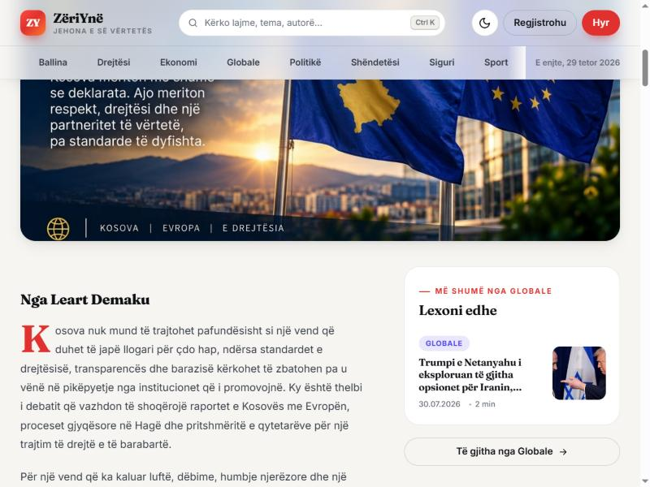
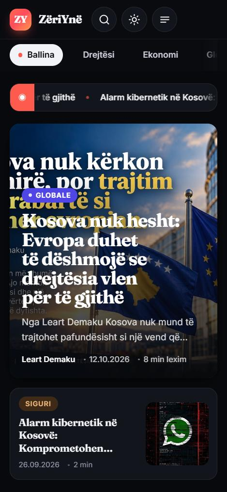
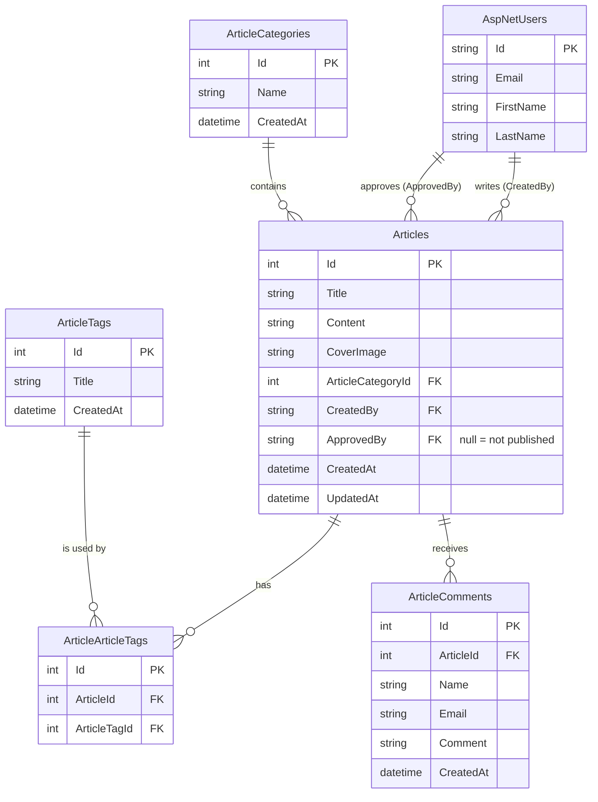

# ZëriYnë — Digital News Portal

> *Jehona e së vërtetës* — "The echo of the truth"

ZëriYnë is a full-stack, Albanian-language news portal built with **ASP.NET Core 8 MVC**, **Entity Framework Core** and **SQL Server**. It has two faces:

- a **public portal** where readers browse news by category and tag, search the archive, read articles and comment;
- an **editorial admin panel** where journalists write articles and editors approve, organise and moderate them.


---

## Table of contents

1. [Screenshots](#screenshots)
2. [Features](#features)
3. [Tech stack](#tech-stack)
4. [Architecture](#architecture)
5. [Data model](#data-model)
6. [Roles and permissions](#roles-and-permissions)
7. [Routes](#routes)
8. [Project structure](#project-structure)
9. [Design system](#design-system)
10. [Getting started](#getting-started)
11. [Configuration](#configuration)
12. [How the project was built](#how-the-project-was-built)
13. [Before going to production](#before-going-to-production)

---

## Screenshots

| Home, light mode | Home, dark mode |
|---|---|
|  |  |

| Article page | Phone, dark mode |
|---|---|
|  |  |

---

## Features

### Public portal

- **Home page** with a live "latest news" ticker, a featured story, three headline cards, the day's editorial feed and a preview block for each category.
- **Category, tag and search pages** that share one listing layout, with article counts and clear empty states.
- **Article page** with a reading-progress bar, breadcrumb, author byline, share buttons (native share on phones, Facebook, X, WhatsApp, copy link), tags, related articles and comments.
- **Comments** with client-side and server-side validation and Albanian error messages.
- **Light and dark mode.** The site follows the operating system by default. The reader's choice is saved in the browser and applied before the first paint, so there is no white flash.
- **Responsive on every screen**: phone (375 px), tablet (768 px) and desktop (1024 px+), with a slide-in menu on phones and a search dialog (`Ctrl + K` or `/`).
- **Accessibility**: skip link, keyboard-friendly dialogs, visible focus rings, `aria-*` labels, and `prefers-reduced-motion` support.
- **SEO and sharing**: meta descriptions, canonical URLs, Open Graph and Twitter cards, and `NewsArticle` structured data (JSON-LD) on every article.
- **Performance**: no Bootstrap or jQuery on public pages (jQuery loads only on pages with forms), lazy-loaded images, and a one-year browser cache for versioned static files.
- **Relative timestamps** such as "3 orë më parë", with the full date kept as a fallback.

### Admin panel

- **Articles**: create, edit and delete, with cover image upload. Journalists see only their own articles; editors see all of them.
- **Editorial approval**: an article appears on the portal only once an editor approves it (`ApprovedBy` is set).
- **Categories and tags**: full management.
- **Comment moderation**: list and delete reader comments.
- **Users and roles**: create users, assign roles and manage role definitions.
- **Its own light/dark theme** and a collapsible sidebar.

---

## Tech stack

| Layer | Technology | Why |
|---|---|---|
| Web framework | ASP.NET Core 8 MVC + Razor Views | Server-rendered HTML: fast first load and good for SEO |
| Auth | ASP.NET Core Identity, with scaffolded and restyled pages | Secure password hashing, roles and login flows out of the box |
| Data access | Entity Framework Core 8 (code-first migrations) | Typed queries; the schema is versioned in code |
| Database | SQL Server Express (LocalDB or full SQL Server also work) | First-class EF Core provider |
| Email | `System.Net.Mail.SmtpClient` behind `IEmailSender` | Password-reset emails; works locally with a mail catcher on port 1025 |
| Public UI | Hand-written CSS (custom properties) + vanilla JavaScript | No build step, small payload, full control over design |
| Admin UI | Bootstrap 5.1 + custom `admin.css` | Fast to build data-heavy forms and tables |
| Fonts | Fraunces (headlines) and Inter (text), via Google Fonts | Editorial look with excellent screen readability |

---

## Architecture

### High-level view

```
                         ┌───────────────────────────────────────────┐
   Reader / Editor       │            ASP.NET Core 8 (Kestrel)       │
   (browser)             │                                           │
        │  HTTPS         │  Middleware pipeline                      │
        ├───────────────►│  HTTPS redirect → Static files → Routing  │
        │                │  → Authentication → Authorization         │
        │                │                │                          │
        │                │      ┌─────────┴──────────┐               │
        │                │      ▼                    ▼               │
        │                │  Portal controllers   Admin controllers   │
        │                │  Home, Sections, Tag  /Admin/* [Authorize]│
        │                │      │                    │               │
        │                │      ▼                    │               │
        │                │  PortalQueryService       │               │
        │                │  (read models, slugs,     │               │
        │                │   summaries, read time)   │               │
        │                │      │                    │               │
        │                │      └─────────┬──────────┘               │
        │                │                ▼                          │
        │                │      ApplicationDbContext (EF Core)       │
        │                └────────────────┬──────────────────────────┘
        │                                 ▼
        │                         SQL Server (PortalApp DB)
        │
        └── static files: /css/portal.css, /js/portal.js, /images/articles/*
```

### Two separate front ends

The portal and the admin panel share the same back end, but each has its own layout, styles and scripts. A change to one cannot break the other.

| | Public portal | Admin panel |
|---|---|---|
| Layout | `Views/Shared/_Layout.cshtml` | `Views/Shared/Admin/_Layout.cshtml` |
| Styles | `wwwroot/css/portal.css` | `wwwroot/css/site.css` + `wwwroot/css/admin.css` |
| Scripts | `wwwroot/js/portal.js` | Bootstrap bundle + `wwwroot/js/admin.js` |
| Libraries | none (jQuery only for form validation) | Bootstrap 5.1, jQuery |

### Request flow: opening an article

```
GET /artikulli/75
  └─► HomeController.Show(75)
        └─► PortalQueryService.GetArticleDetailsAsync(75)
              ├─ loads the article only if ApprovedBy != null (approved)
              ├─ includes category, author, tags, comments
              ├─ loads up to 3 related articles from the same category
              └─ maps everything to PortalArticleDetailsViewModel
        └─► Views/Home/Show.cshtml rendered inside _Layout.cshtml
              ├─ <head>: meta description, Open Graph, JSON-LD NewsArticle
              └─ body: article, share buttons, comments, related articles
```

### Request flow: posting a comment

```
POST /Home/Comment/75   (form fields: CommentForm.Name, CommentForm.Email, CommentForm.Comment)
  └─► anti-forgery token checked  ([ValidateAntiForgeryToken])
  └─► fields bound with [Bind(Prefix = "CommentForm")]
  └─► article must exist and be approved
  ├─ invalid → the article page is shown again with Albanian error messages
  └─ valid   → comment saved → redirect to /artikulli/75   (Post/Redirect/Get pattern)
```

### Key design decisions

- **View models instead of entities in views.** The portal never passes EF entities to Razor. `PortalQueryService` maps them to small, flat view models (`PortalArticleCardViewModel` and others), so views stay simple and lazy-loading surprises are impossible.
- **Read-only queries use `AsNoTracking()`.** The portal only reads data, so EF Core skips change tracking. This is faster and uses less memory.
- **Category metadata lives in code.** `PortalSectionRegistry` maps each category to a URL slug (`Shëndetësi` → `shendetesi`), a description and an accent colour. Every category gets a consistent colour across navigation, chips and cards.
- **Theme before first paint.** A small inline script in `<head>` reads `localStorage` (or the system preference) and sets `data-theme` on `<html>` before the CSS renders.
- **Progressive enhancement.** Every page works without JavaScript. JavaScript only adds the dialogs, ticker, animations, relative times and share buttons.

---

## Data model



Identity adds its standard tables (`AspNetRoles`, `AspNetUserRoles` and others). `ApplicationUser` extends `IdentityUser` with `FirstName` and `LastName`.

---

## Roles and permissions

The app seeds these roles on startup: **Drejtor** (director), **Admin**, **Administrator**, **Redaktor** (editor) and **Gazetar** (journalist).

| Area | Drejtor / Admin / Administrator | Redaktor | Gazetar | Registered reader |
|---|:-:|:-:|:-:|:-:|
| Read the portal and comment | ✅ | ✅ | ✅ | ✅ |
| "Paneli" link in the portal header | ✅ | ✅ | ✅ | — |
| Write and edit **own** articles | ✅ | ✅ | ✅ | ⚠️ see note |
| See and edit **all** articles, approve and publish | ✅ | ✅ | — | — |
| Categories, tags, comment moderation | ✅ | ✅ | — | — |
| Users and roles | ✅ | — | — | — |

> ⚠️ `AdminArticleController` uses a plain `[Authorize]`, so any signed-in account can open it and write drafts. Drafts stay hidden from the portal until an editor approves them. If public sign-up stays enabled, restrict this controller to staff roles.

---

## Routes

### Public portal

| URL | What it shows |
|---|---|
| `/` | Home page |
| `/kategori/{slug}` | Category page, e.g. `/kategori/teknologji` |
| `/tag/{name}` | Articles with a tag |
| `/kerko?q=...` | Search in titles, content, categories and tags |
| `/artikulli/{id}` | Article page |
| `POST /Home/Comment/{id}` | Submit a comment |
| `/Home/Privacy` | Privacy policy |
| `/ekonomi`, `/sport`, `/globale`, `/politike`, `/shendetesi`, `/teknologji` | Old URLs; permanent (301) redirect to `/kategori/...` |

### Accounts (ASP.NET Core Identity)

`/Identity/Account/Login`, `/Register`, `/ForgotPassword`, `/ResetPassword`, `/Logout`

### Admin panel

`/Admin/{Controller}/{Action}/{id?}` for `AdminArticle`, `AdminArticleCategory`, `AdminArticleTag`, `AdminArticleComment`, `AdminUser` and `AdminUserRole`.

---

## Project structure

```
portal_application/
├── PortalApp.sln
├── README.md
├── PORTAL_PLAN.md                  # plan and prompt used for the portal redesign
├── SQLQuery.sql                    # optional sample data (⚠️ deletes existing articles first)
├── docs/screenshots/               # images used in this README
└── PortalApp/
    ├── Program.cs                  # services, seeding, middleware pipeline
    ├── appsettings.json            # connection string, SMTP, logging
    ├── Areas/Identity/Pages/       # scaffolded and restyled login/register pages
    ├── Controllers/
    │   ├── HomeController.cs       # home, article, comments, search, privacy, error
    │   ├── SectionsController.cs   # /kategori/{slug}
    │   ├── TagController.cs        # /tag/{name}
    │   ├── *Controller.cs          # legacy category URLs → 301 redirects
    │   └── Admin/                  # admin panel controllers ([Authorize])
    ├── Data/ApplicationDbContext.cs
    ├── Migrations/                 # EF Core migrations (schema history)
    ├── Models/                     # entities + ViewModels/
    ├── Services/
    │   ├── PortalQueryService.cs   # all read queries for the portal
    │   ├── PortalSectionRegistry.cs# category slugs, descriptions, colours
    │   └── EmailSender.cs          # SMTP implementation of IEmailSender
    ├── Views/
    │   ├── Shared/_Layout.cshtml   # portal layout (header, footer, dialogs)
    │   ├── Shared/Admin/           # admin layout
    │   ├── Shared/Partials/        # listing page, validation scripts
    │   ├── Home/                   # home, article, search + card partials
    │   ├── Sections/, Tag/         # listing pages
    │   └── Admin/                  # admin pages
    └── wwwroot/
        ├── css/portal.css          # portal design system
        ├── css/site.css, admin.css # admin styles
        ├── js/portal.js            # theme, dialogs, ticker, sharing, animations
        ├── images/articles/        # uploaded cover images
        ├── images/portal/          # placeholder image
        └── lib/                    # Bootstrap, jQuery, validation (admin + forms)
```

---

## Design system

All public styles live in [`PortalApp/wwwroot/css/portal.css`](PortalApp/wwwroot/css/portal.css) and are built on CSS custom properties ("design tokens"):

```css
:root                { --bg: #f6f5f1; --surface: #ffffff; --ink: #0e1015; --brand: #e0312f; }
:root[data-theme="dark"] { --bg: #08090c; --surface: #12151b; --ink: #f2f3f6; --brand: #ff5a4e; }
```

Components only use tokens (`var(--surface)`, `var(--ink)` and so on), so dark mode needs no duplicated component CSS. Each category also sets `--accent` (from `PortalSectionRegistry`), which colours its chips, dots and highlights.

| Token group | Examples |
|---|---|
| Colours | `--bg`, `--surface`, `--ink`, `--muted`, `--line`, `--brand`, `--accent` |
| Typography | `--font-display` (Fraunces), `--font-sans` (Inter), fluid sizes with `clamp()` |
| Shape and depth | `--radius-sm` … `--radius-xl`, `--shadow-sm` … `--shadow-lg` |
| Motion | `--ease`, `--dur`; turned off under `prefers-reduced-motion` |
| Breakpoints | 560 px, 768 px, 1024 px (mobile first) |

---

## Getting started

### Prerequisites (Windows)

- [.NET 8 SDK](https://dotnet.microsoft.com/download/dotnet/8.0)
- SQL Server Express (instance `.\SQLEXPRESS`), or change the connection string to LocalDB or another server
- The EF Core CLI tool:

  ```powershell
  dotnet tool install --global dotnet-ef --version 8.*
  ```

- Optional, for password-reset emails: a local SMTP catcher on port 1025, such as [smtp4dev](https://github.com/rnwood/smtp4dev) or [Mailpit](https://mailpit.axllent.org/)

### Run locally

```powershell
git clone https://github.com/LeartDemaku/portal_application.git
cd portal_application\PortalApp

# create the database from the migrations
dotnet ef database update

# start the app
dotnet run --launch-profile http
```

Open **http://localhost:5200**.

On the first start, `Program.cs` seeds the roles, the default categories and tags, and one staff account per role (`admin@portal.com`, `drejtor@portal.com`, `redaktor@portal.com`, `gazetar@portal.com`). The initial password is in `Program.cs`. Change it immediately (see [Before going to production](#before-going-to-production)).

### Useful commands

| Command | What it does |
|---|---|
| `dotnet build` | Compile the app and all Razor views |
| `dotnet watch --launch-profile http` | Run and reload automatically on file changes |
| `dotnet ef migrations add <Name>` | Create a migration after changing a model |
| `dotnet ef database update` | Apply pending migrations |

---

## Configuration

`PortalApp/appsettings.json`:

| Key | Default | Meaning |
|---|---|---|
| `ConnectionStrings:DefaultConnection` | `Server=.\SQLEXPRESS;Database=PortalApp;Trusted_Connection=True;...` | SQL Server connection |
| `SmtpSettings:Host` / `Port` | `localhost` / `1025` | SMTP server for Identity emails |
| `SmtpSettings:Username` / `Password` | `admin@localhost` / empty | SMTP credentials |
| `SmtpSettings:EnableSsl` | `false` | Use TLS for SMTP |

Never commit real passwords. For local secrets use [User Secrets](https://learn.microsoft.com/aspnet/core/security/app-secrets) (the project already has a `UserSecretsId`):

```powershell
dotnet user-secrets set "SmtpSettings:Password" "your-password" --project PortalApp
```

On a host, use environment variables instead. `__` stands for `:`, for example `SmtpSettings__Password` or `ConnectionStrings__DefaultConnection`.

---

## How the project was built

### Timeline

| Date | Milestone |
|---|---|
| 2026-04-22 | **Database first:** `Init` migration with articles, categories, tags, the article–tag link table and comments |
| 2026-04-27 | **Identity added:** user accounts, then the custom `ApplicationUser` |
| 2026-05-04 | Cover images for articles, commenter email, users' first and last name |
| 2026-05-07 | Articles get an **author** (`CreatedBy`), enabling "my articles" |
| 2026-05-14 | **Editorial approval:** `ApprovedBy` on articles; only approved articles reach the portal |
| 2026-05-20 | First commit to GitHub |
| 2026-05 → 08 | Iterations on the portal UI, navbar, branding (ZëriYnë) and forms |
| 2026-10-26 | **Admin panel redesign** with its own layout, styles and light/dark theme |
| 2026-10-29 | `.gitignore` for .NET; build output (`bin/`, `obj/`, `.vs/`) removed from Git |
| 2026-10-29 | **Public portal redesign**: new design system, light/dark mode, responsive layout, SEO, comment bug fix |

### Step by step

1. **Create the solution.** An ASP.NET Core 8 MVC project (`PortalApp`) inside `PortalApp.sln`, with Razor views and the `wwwroot` folder for static files.
2. **Model the content.** Entity classes in `Models/`: `Article`, `ArticleCategory`, `ArticleTag` and the link entity `ArticleTags`. They are registered as `DbSet`s in `Data/ApplicationDbContext.cs`.
3. **Connect to SQL Server.** `UseSqlServer(...)` in `Program.cs`, with the connection string in `appsettings.json`. The first migration (`Init`) is created with `dotnet ef migrations add` and applied with `dotnet ef database update`.
4. **Add authentication.** ASP.NET Core Identity with a custom `ApplicationUser : IdentityUser` and role support (`AddIdentity<ApplicationUser, IdentityRole>()`). The login, register and password pages are scaffolded into `Areas/Identity` so they can be translated and restyled.
5. **Seed the basics.** On startup, `Program.cs` creates the roles, the default categories and tags, and one staff user per role, so a fresh database is usable at once.
6. **Build the editorial workflow.** Admin controllers under `Controllers/Admin` with role-based `[Authorize]`. Articles save cover images to `wwwroot/images/articles` with GUID file names. An editor sets `ApprovedBy` to publish.
7. **Build the read side.** `PortalQueryService` holds every portal query (only approved articles, newest first), and `PortalSectionRegistry` handles slugs and category colours. The controllers stay thin: they call the service and return a view.
8. **Add comments.** An `ArticleComment` entity, a POST action with anti-forgery protection and validation, and the Post/Redirect/Get pattern.
9. **Design the admin panel.** A dedicated admin layout with sidebar, its own CSS and JS, and a light/dark theme.
10. **Redesign the public portal.** A new `portal.css` design system and `portal.js`, with no Bootstrap. Light/dark mode, responsive layouts, an accessible search dialog and mobile menu, SEO metadata and structured data, Albanian validation messages, and fixes found on the way (see [`PORTAL_PLAN.md`](PORTAL_PLAN.md)).
11. **Clean the repository.** The official .NET `.gitignore` (`dotnet new gitignore`), and build output removed from version control with `git rm --cached`.

---

## Before going to production

These are known gaps. Fix them before a public launch:

- [ ] **Change the seeded passwords.** `Program.cs` creates staff accounts with a fixed password and **resets the admin password on every start**. Remove the reset and move initial credentials to configuration or secrets.
- [ ] **Sanitize article HTML.** Article content is rendered with `Html.Raw`, so a `<script>` inside an article would run for every reader. Sanitize on save or on render, for example with [HtmlSanitizer](https://github.com/mganss/HtmlSanitizer).
- [ ] **Validate image uploads.** Allow only image types (`.jpg`, `.png`, `.webp`), check the file content and limit the size.
- [ ] **Restrict `AdminArticleController`** to staff roles if public registration stays open.
- [ ] **Forwarded headers.** Behind a reverse proxy, call `UseForwardedHeaders` so canonical and Open Graph URLs use `https` and the public host name.
- [ ] **Store uploads outside the app folder** (or in blob storage), so redeploys do not delete cover images.
- [ ] **Configure real SMTP** credentials via environment variables.
- [ ] **Add automated tests and CI** (for example GitHub Actions running `dotnet build` and `dotnet test`).

---

**Author:** Leart Demaku
